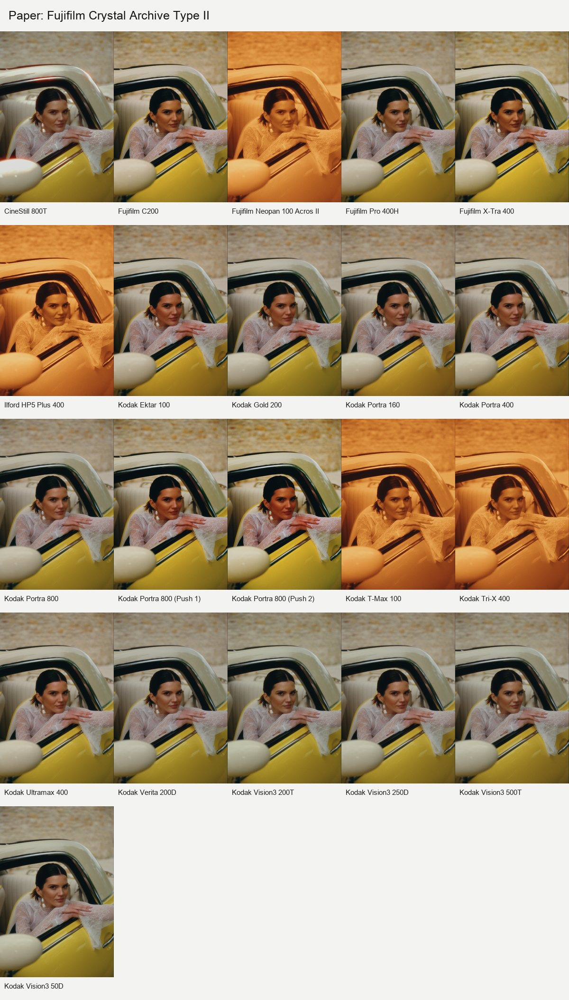
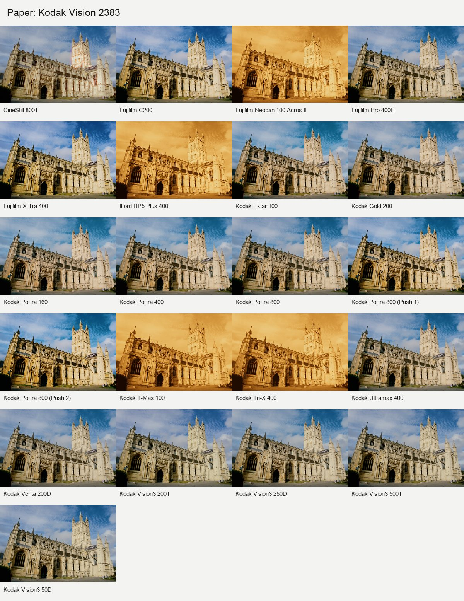
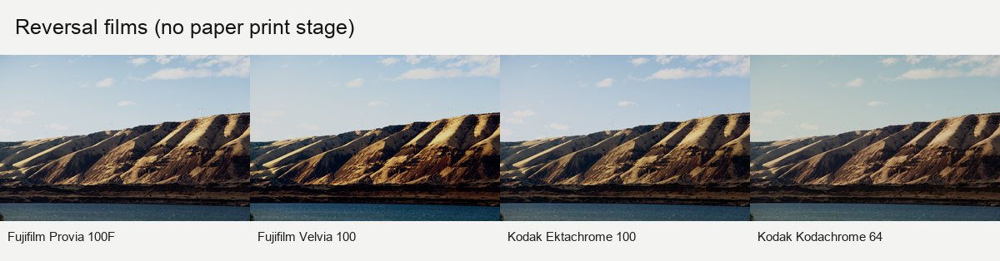
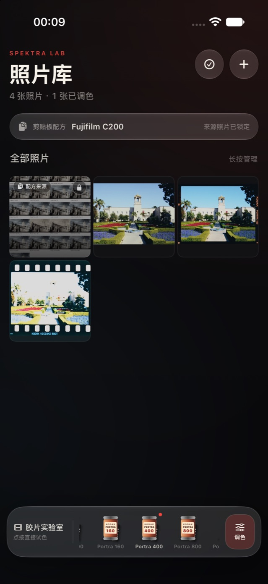
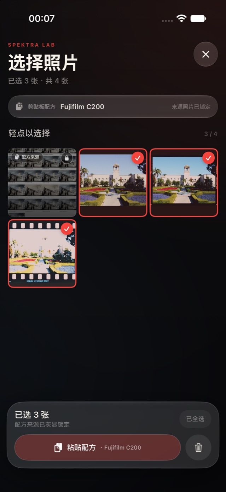
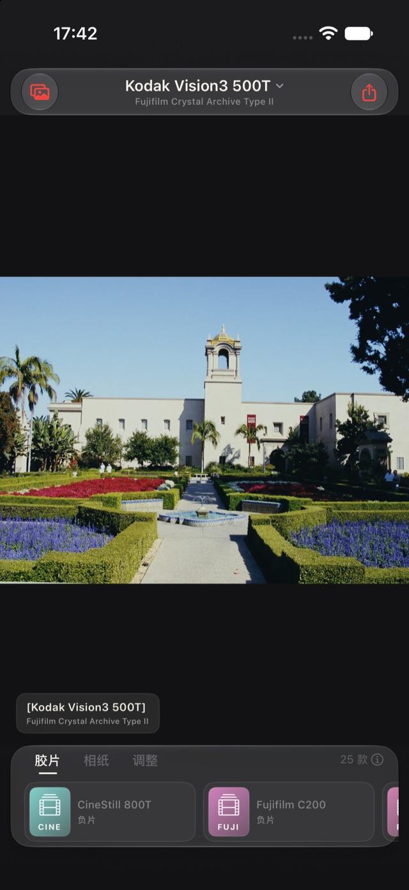
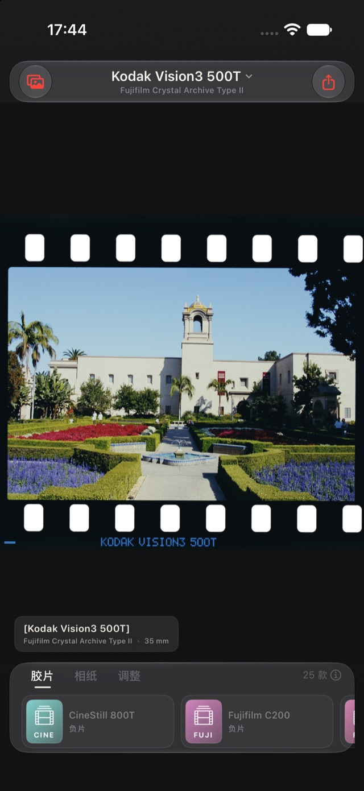
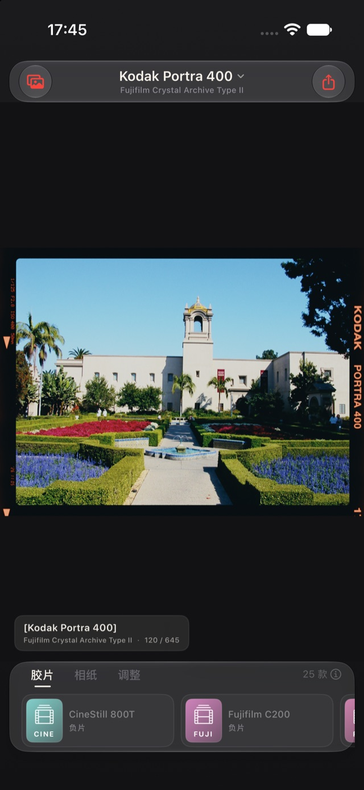
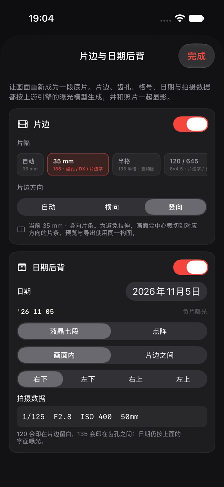

# SpektraLab for iOS

SpektraLab 的 iPhone 社区移植版。它在设备上用 C++20 与 Metal 运行胶片和相纸的物理模拟：胶片曝光、染料层、颗粒、光晕、放大与相纸成像，而不是给照片套一张 LUT。

> 这不是 SpektraLab 官方 iOS 客户端。核心引擎来自 [JamesQiu2005/SpektraLab](https://github.com/JamesQiu2005/SpektraLab)；本仓库维护 iOS 界面、RAW/JPEG 导入、Metal 适配、全分辨率导出与自动构建。

## 下载与安装

前往 **[Latest Release](https://github.com/Minerchu/SpektraLab-iOS/releases/latest)** 下载最新 IPA。Release 每次由 `main` 的最新成功构建替换，资产文件名带有提交号，避免 CDN 返回旧包。

当前版本：**1.2.0**。本版把首页重构为照片墙与常驻“胶片实验室”，编辑后的缩略图直接回到照片墙；复制配方会锁定来源照片，并可多选一键粘贴整套胶片、相纸、片边与调整参数。胶片和相纸图标改为拟物胶卷罐，原有的物理片边、日期后背和 RAW 解码链路保持不变。

推荐下载文件名以 **`-unsigned.ipa`** 结尾的版本：

| 工具 | 使用方式 |
|---|---|
| SideStore / AltStore | 选择未签名 IPA，用自己的 Apple ID 重签并安装 |
| Sideloadly | 选择未签名 IPA；若 Release 同时提供 ad-hoc 版也可使用 |
| Xcode | 克隆源码，在 Signing 中选择自己的 Personal Team 后运行 |

Release 中的 IPA 不包含你的个人开发证书，不能直接安装。免费 Apple ID 的签名通常 7 天后过期，需要续签。最低系统版本为 **iOS 16.0**。iOS 26 及以上仍使用原生 Liquid Glass，iOS 16~25 自动回退到材质界面。

## 功能

| 项目 | 状态 |
|---|---|
| 系统与工具链 | iOS 16.0+、Xcode 16.4 或更新版本、Swift 6、C++20、Metal |
| 界面 | iOS 26+ 原生 Liquid Glass，低版本材质回退；照片墙、胶片实验室底栏、动态片名标题、沉浸预览与紧凑单行片库 |
| 照片墙 | 多图导入；编辑返回后刷新冲洗缩略图；底栏可直接点胶片试色或进入调色 |
| 配方 | 复制后锁定来源照片并自动排除选择；多选一键粘贴胶片、相纸、片边和调整参数 |
| 导入 | JPEG、DNG/Apple ProRAW、Sony ARW、Canon CR3、Nikon NEF 等相机 RAW |
| 导出 | 原始像素分辨率的 sRGB JPEG；16-bit 引擎结果直接编码；解码上限 6400 万像素 |
| 预览 | 自适应宽高比，支持缩放、拖动、双击复位与单指点按沉浸模式 |
| 片边 | 135 齿孔/DX、120 645–6×9、半格与全景片幅；片边方向可自动/横向/竖向，实际参与裁切和导出 |
| 日期后背 | LCD 七段/点阵日期；120 片边拍摄数据；曝光进入负片而非 UI 叠加 |
| 配置 | 25 款胶片/正片、9 款相纸与电影打印片 |

引擎资源随 IPA 内置，首次启动只在本地解包，不依赖网络。仍处于测试阶段；不同 iPhone 和 iOS 版本支持的 RAW 型号可能不同，重要照片请保留原文件。

## 实测预览

以下联系表由正式 iOS `ImageDecoder` 解码为 float32 线性 ProPhoto，再通过项目自身的 C++/Metal 引擎生成。输出与 App 一样使用 sRGB，色彩空间转换由 Core Image 完成。

**Nikon Z6 II · Fujifilm Crystal Archive Type II**



**Olympus ORF · Kodak Vision 2383**



**Canon CR3 · 反转片**



## 照片墙与配方

导入照片后先进入照片墙。底部常驻“胶片实验室”，拟物胶卷罐会显示品牌、型号与感光度；点按即可用该胶片打开最新照片，右侧“调色”进入完整编辑。复制配方后，来源照片会降饱和锁定，全选和粘贴都会自动跳过它。



配方包含胶片、相纸、片边、日期后背与调整参数。多选其他照片后点“粘贴配方”，缩略图会通过真实引擎逐张重渲染，再带回照片墙。



## 编辑器与片边

顶部直接显示当前胶片与相纸，底部只留一行片库和三分类标签。点按照片进入无干扰预览，再点一次恢复控件。



开启“片边”后，画面会被居中裁切到所选真实片幅，再由引擎在负片上生成片基、齿孔、片边字与格号；全分辨率导出使用同一裁切。



日期后背和 120 拍摄数据同样经过胶片曝光、显影、颗粒与光晕，不是后期贴字。





## 使用

1. 启动 App，等待内置引擎资源在本地解包。
2. 在照片墙顶部点击“+”，从相册或“文件”批量导入 JPEG / RAW。Sony ARW 等相机 RAW 建议从“文件”导入原始文件，避免系统只提供相册预览图。
3. 轻点照片进入编辑器；顶部标题会同步显示当前胶片与相纸，底部可在“胶片 / 相纸 / 调整”之间切换。
4. 在“调整”中修改曝光、颗粒、光晕等参数；同一页的“片边 / 日期”入口可以打开物理片边、日期后背与拍摄数据，并选择片边方向。
5. 双指缩放、拖动查看细节；双击照片在适合屏幕和沉浸模式间切换，单指点按也可以隐藏或恢复控件。
6. 返回照片墙后，长按已调色照片复制配方；来源图会灰显锁定。点右上角进入多选，选择其他照片后点“粘贴配方”。
7. 点击导出，App 会重新读取原图、按原始分辨率完整渲染，并写入系统相册；开启片边时按同一片幅裁切。

## 图像与色彩管线

### 导入

- JPEG 由 ImageIO/Core Image 解码，直接转换到引擎需要的线性 ProPhoto RGB。
- 相机 RAW 优先交给 Core Image。App 会从文件扩展名、相册选择器或容器签名恢复真实 RAW UTI，因为 iOS 常把 ARW/NEF 报告成 `public.tiff`，直接使用系统返回值会丢失厂商配置。
- Core Image 返回空图、内嵌缩略图、明显低分辨率结果，或拒绝 TIFF 容器的 RAW 时，回退到内置的 **LibRaw 0.22.2**。
- LibRaw 回退策略与桌面版一致：相机白平衡、AHD、不自动提亮，输出线性 ProPhoto RGB。
- 预览长边限制为 2048 px；导出时重新解码原始文件并使用原始像素分辨率。

### 色彩管理

- 引擎输入为**线性 ProPhoto RGB**，`input_cctf_decoding = false`。
- 引擎输出为 **sRGB**，与 macOS preview host 保持一致。
- 输入与输出的色彩空间转换全部交给 **Core Image**；App 不使用自建转换矩阵，也不手写 gamma 曲线。
- 画布 `CAMetalLayer` 与导出 JPEG 都标记为 sRGB，不做二次转换。

### 导出

- 导出直接读取引擎的 16-bit `spk_result.rgba16`，通过 `CGDataProvider` 交给 ImageIO 编码。
- 不再生成全尺寸 RGBA8 副本，避免 24–26 MP 导出时的内存峰值。
- 已在 iOS 27.2 模拟器完成 6240×4168 Sony ARW 的全尺寸 `decode → render → JPEG` 验证；目标真机仍需逐项复测。

### 片边与日期后背

- 片边来自上游引擎的 overscan 实现：画面外是同一段负片上的片基、齿孔、DX 码、片边字、格号、边缘雾化和光晕，随后与画面一起显影。
- 引擎只接受与片幅比例相差不超过 5% 的画面，因此开启片边时 App 会先按片幅做居中裁切。预览在内存中裁切，全分辨率导出在解码阶段裁切，避免多复制一整张高像素图像。
- 片边方向可选“自动 / 横向 / 竖向”。自动会跟随照片本身的方向；手动方向会改变中心裁切，例如竖图选择横向时，画面保持正向，但会裁成横向片条，不是给图片叠一个旋转边框。预览、Core Image、LibRaw 回退和全分辨率导出使用同一目标比例。
- 可选 135 全画幅、135 半格、120 / 645、6×6、6×7、6×8、6×9、XPan、6×12 与 6×17。“自动”对普通横竖画幅优先 35 mm，方形照片使用 6×6，只有接近全景比例时才选择 XPan、6×12 或 6×17；其余 120 片幅可手动选择。
- 日期后背支持液晶七段和点阵字面。135 可放在画面内或帧间；120 默认印在片边留白。全景片幅不支持日期后背。
- 拍摄数据在 120 印于片边、135 印于齿孔之间。日期和数据都以相机背光曝光进负片，并继承胶片颗粒与光晕。

## 本地构建

### 要求

- Apple silicon Mac
- macOS 与 Xcode 16.4 或更新版本（Xcode 27.2 亦可）
- iOS 18 或更新的 SDK，部署目标固定为 iOS 16.0
- Python 3.10+
- 安装到真机时，Xcode 已登录 Apple ID

构建前可在任意系统（含 Windows）运行 `python3 ios/Tools/check-ios16-compat.py`，核对四处部署目标一致且没有未加保护的 iOS 17/26 API。

### 获取源码与引擎

```bash
git clone https://github.com/Minerchu/SpektraLab-iOS.git
cd SpektraLab-iOS

# 上游引擎不在本仓库。fetch-engine.py 会校验所需文件与资源。
# 未设置 GITHUB_TOKEN 时很容易触发 GitHub API 的匿名限流。
GITHUB_TOKEN="<你的 GitHub Token>" python3 tools/fetch-engine.py \
  JamesQiu2005/SpektraLab \
  02d82b56cf65f0f8e802a708612edc4e9a4790af \
  .

python3 tools/apply-ios-patch.py engine
```

### 准备 LibRaw 与 Metal 资源

```bash
# 下载并校验固定的 LibRaw 0.22.2
bash engine/setup-libraw.sh

# 编译真机 Metal 内核，并打包 profiles / LUT / 色彩配置
ios/Tools/build-engine.sh bundle device
```

### 生成工程

```bash
python3 ios/Tools/gen-project.py
open ios/SpektraLab.xcodeproj
```

在 Xcode 的 **Signing & Capabilities** 中选择自己的 Team，然后连接 iPhone 运行。

App 图标是可选项。需要重新生成时：

```bash
python3 -m pip install Pillow
python3 tools/make-app-icon.py
cp ios/SpektraLab/Assets.xcassets/AppIcon.appiconset/icon-60@2x.png \
   ios/SpektraLab/AppIcon60x60@2x.png
cp ios/SpektraLab/Assets.xcassets/AppIcon.appiconset/icon-60@3x.png \
   ios/SpektraLab/AppIcon60x60@3x.png
python3 ios/Tools/gen-project.py
```

模拟器必须重新打包模拟器版本，不能复用真机 `.metallib`：

```bash
ios/Tools/build-engine.sh bundle simulator
python3 ios/Tools/gen-project.py
```

命令行无签名真机构建：

```bash
xcodebuild \
  -project ios/SpektraLab.xcodeproj \
  -scheme SpektraLab \
  -configuration Release \
  -destination 'generic/platform=iOS' \
  CODE_SIGNING_ALLOWED=NO \
  build
```

## GitHub Actions

向 `main` 推送代码后，工作流会：

1. 通过 API 获取固定提交的上游引擎并应用 iOS 补丁。
2. 下载并校验 LibRaw 0.22.2。
3. 编译安全数学模式的 Metal 内核，打包引擎资源。
4. 生成 App 图标与 Xcode 工程。
5. 无签名构建，并按可重签格式打包 IPA。
6. 替换滚动的 `latest` Release。

未配置签名 secret 时，发布的 IPA 需要 SideStore、AltStore、Sideloadly 或 Xcode 重签。要生成带开发证书的 IPA，需要配置：

- `IOS_CERTIFICATE_P12`
- `IOS_CERTIFICATE_PASSWORD`
- `IOS_CERTIFICATE_IDENTITY`
- `IOS_PROVISIONING_PROFILE`
- `IOS_PROVISIONING_PROFILE_NAME`
- `IOS_TEAM_ID`
- `IOS_BUNDLE_ID`

不要把证书、密码、GitHub Token 或 Apple ID 凭据提交到仓库。

## 目录

| 路径 | 内容 |
|---|---|
| `ios/SpektraLab/` | SwiftUI 界面、片边/日期控制、RAW/JPEG 导入、Metal 画布、状态与导出 |
| `ios/Tools/` | Metal 资源、Xcode 工程与 IPA 打包脚本 |
| `tools/` | 上游引擎下载、iOS 补丁与图标工具 |
| `.github/workflows/` | CI 构建与 Release 发布 |
| `docs/` | iOS 移植技术说明、联系表、界面截图与构建记录 |

更深入的技术决策见 [`docs/IOS-PORT-NOTES.md`](docs/IOS-PORT-NOTES.md)。

## 已知限制

- Core Image 不支持的相机 RAW 会尝试 LibRaw；个别厂商压缩格式仍可能无法解码。
- Apple ProRAW 建议从“文件”导入原始 DNG；从照片库选择时，系统有时只提供渲染后的图像。
- 全尺寸 RAW 导出以及片边/日期合成已在 iOS 27.2 模拟器验证；尚未在目标 iPhone 上完成内存峰值和相册写入复测。
- 当前解码上限为 6400 万像素；全尺寸导出会比低清预览更耗时，也占用更多内存。
- 开启片边会为了匹配真实片幅而居中裁切照片；“自动”跟随原图方向，手动横向/竖向会改变片条和构图。当前 UI 尚未提供手动移动裁切框。
- 日期后背在 135 与 120 645–6×9 上可用；全景片幅按真实相机限制不提供日期。
- 曲线编辑器、色轮、半格拼接和几何裁剪尚未在 iPhone UI 中开放；批量套用目前通过配方粘贴完成。
- 免费 Apple ID 的侧载签名通常需要每 7 天续签。

## 许可与致谢

- 核心引擎与胶片过程模型：[JamesQiu2005/SpektraLab](https://github.com/JamesQiu2005/SpektraLab)，GPL-3.0-or-later。
- 胶片模型、实测配置与放大 LUT：[Andrea Volpato/spektrafilm](https://github.com/andreavolpato/spektrafilm)，CC BY-SA 4.0。
- RAW 回退解码：[LibRaw](https://github.com/LibRaw/LibRaw) 0.22.2，LGPL-2.1 / CDDL-1.0。
- iOS 移植代码：GPL-3.0-or-later。

代码按 **GPL-3.0-or-later** 分发；胶片与相纸配置按 **CC BY-SA 4.0** 分发。第三方项目的商标和名称归各自权利人所有。
